# SDLL CAVE 콘텐츠 제작 및 실행

`CAVE_Content_Starter`는 Unreal Engine에서 SDLL CAVE용 콘텐츠를 제작하고 여러 화면에 출력하기 위한 프로젝트입니다. 정면, 왼쪽, 오른쪽, 후면, 천장의 5개 면에 8개 화면을 출력합니다. 여러 화면에 맞춰 장면을 그리는 Unreal 기능인 **nDisplay**를 사용합니다.

콘텐츠는 `CAVE_Content_Sample`에서 제작합니다. `CAVE_nDisplay_Sample`에서 콘텐츠를 CAVE 화면 배치와 함께 확인한 뒤, 에디터의 **nDisplay Launch**로 출력을 실행합니다. 이 문서는 프로젝트 열기부터 레벨 편집, nDisplay 설정, 현장 실행까지의 절차를 안내합니다.

아래 캡처는 **Unreal Engine 5.8.3의 영문 UI**를 기준으로 합니다. 사진을 클릭하면 크게 볼 수 있습니다.

- [프로젝트 열기](#프로젝트-열기)
- [프로젝트 구성 이해하기](#프로젝트-구성-이해하기)
- [콘텐츠 제작하기](#콘텐츠-제작하기)
- [CAVE 화면에서 확인하기](#cave-화면에서-확인하기)
- [nDisplay 설정하기](#ndisplay-설정하기)
- [CAVE 출력 실행하기](#cave-출력-실행하기)

## 프로젝트 열기

프로젝트의 기준 환경은 **Unreal Engine 5.8.3, Windows, DirectX 12**입니다. 필요한 nDisplay와 에디터의 nDisplay Launch 기능은 프로젝트에 이미 켜져 있습니다.

### Git에서 내려받기

Git과 Git LFS를 설치한 뒤, 프로젝트를 저장할 폴더에서 PowerShell을 열고 다음 명령을 실행합니다.

```powershell
git lfs install
git clone https://github.com/wrlab/sdll-unreal-sample.git CAVE_Content_Starter
cd CAVE_Content_Starter
git lfs pull
```

장면과 설정을 저장하는 Unreal 파일인 `.umap`과 `.uasset`은 Git LFS로 관리됩니다. `git lfs pull`이 완료되면 이 파일들의 다운로드가 끝납니다.

### Unreal Editor에서 열기

1. `CAVE_Content_Starter.uproject`를 Unreal Engine 5.8.3으로 엽니다.
2. 화면에 사용할 재질과 효과를 준비하는 **셰이더 컴파일**이 끝날 때까지 기다립니다.
3. 시작 레벨인 `CAVE_Content_Sample`에서 격자, 큐브, 구체를 확인합니다.

다른 레벨이 열려 있다면 **Content Browser > Content > Maps**에서 `CAVE_Content_Sample`을 엽니다.

에디터에서는 다음 세 창을 주로 사용합니다.

| 창 | 사용하는 때 |
| --- | --- |
| Content Browser | 프로젝트에 저장된 장면 파일, 모델, 재질, 설정 파일을 찾고 엽니다. |
| Outliner | 현재 열린 장면의 오브젝트, 조명, 카메라를 목록에서 선택합니다. |
| Details | 선택한 항목의 위치, 크기와 설정값을 확인하고 수정합니다. |

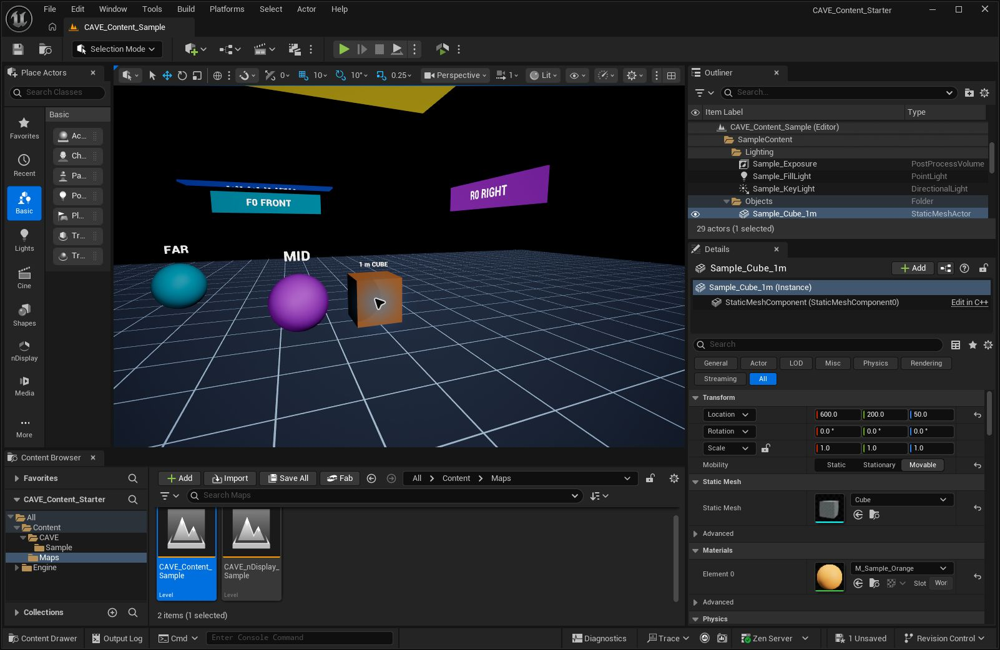

*아래쪽 Content Browser의 Maps 폴더에 두 레벨이 있습니다. 오른쪽 위는 장면의 목록인 Outliner, 오른쪽 아래는 선택한 큐브의 Details입니다. 이 사진은 장면을 보기 쉽도록 뷰포트의 보조 아이콘을 G 키로 숨긴 상태입니다.*

## 프로젝트 구성 이해하기

### 주요 파일의 역할

Unreal에서 **레벨**(Level)은 오브젝트와 조명을 배치한 장면을 저장하는 파일입니다. **에셋**(Asset)은 프로젝트에서 사용하는 모델, 재질, 설정 파일 같은 자료를 뜻합니다.

| 이름 | 형식 | 역할 |
| --- | --- | --- |
| `CAVE_Content_Sample` | 레벨 `.umap` | **SDLL용 콘텐츠 제작을 위한 레벨**입니다. 오브젝트, 조명, 연출을 배치하고 수정합니다. |
| `CAVE_nDisplay_Sample` | 레벨 `.umap` | 제작한 콘텐츠가 CAVE의 각 화면에 어떻게 보이는지 확인하고 실행하는 레벨입니다. |
| `NDC_CAVE_Sample` | nDisplay 구성 에셋 `.uasset` | CAVE 화면의 위치와 크기, 관람자의 눈 위치, 화면별 출력 방법을 저장한 설정 파일입니다. |
| `NDC_CAVE_Sample.ndisplay` | 내보낸 설정 파일 | 위 구성 에셋에서 **Export** 기능으로 만든 파일입니다. 화면 배치와 출력 노드 설정을 텍스트로 저장합니다. |

제작과 실행에 사용하는 주요 파일은 다음 위치에 있습니다.

```text
CAVE_Content_Starter/
├─ CAVE_Content_Starter.uproject
├─ Config/                         # 프로젝트와 렌더링 설정
├─ Content/
│  ├─ Maps/
│  │  ├─ CAVE_Content_Sample.umap
│  │  └─ CAVE_nDisplay_Sample.umap
│  └─ CAVE/Sample/
│     ├─ NDC_CAVE_Sample.uasset
│     ├─ NDC_CAVE_Sample.ndisplay
│     └─ M_Sample_*.uasset          # 샘플 오브젝트의 색상과 표면 재질
├─ Preview/                        # 문서에 사용하는 이미지
└─ README.md
```

### 두 레벨의 연결 방식

`CAVE_Content_Sample`에서 콘텐츠를 만들고 저장한 뒤, `CAVE_nDisplay_Sample`을 열어 CAVE 화면 배치와 함께 확인합니다. 실행용 파일인 `CAVE_nDisplay_Sample`이 제작용 파일인 `CAVE_Content_Sample`을 함께 불러오도록 연결되어 있기 때문입니다.

예를 들어 제작용 파일에서 큐브를 위로 옮기고 저장하면, 실행용 파일을 열었을 때도 그 큐브가 옮긴 위치에 나타납니다. 실행용 파일은 같은 콘텐츠 원본을 불러오므로, 수정할 때마다 콘텐츠를 다시 복사할 필요가 없습니다.

```text
CAVE_nDisplay_Sample
├─ CAVERig                    CAVE 화면 배치를 담당하는 오브젝트
└─ CAVE_Content_Sample        함께 불러오는 콘텐츠 파일
   └─ SampleContent          콘텐츠 오브젝트와 조명
```

Unreal의 **Levels** 창에서는 실행용 레벨을 **Persistent Level**로 표시하며, 함께 불러온 콘텐츠 레벨을 **서브레벨**이라고 부릅니다. 이 프로젝트의 **Always Loaded** 설정은 실행할 때 콘텐츠 레벨을 항상 함께 불러오도록 합니다.

연결 상태를 보려면 `CAVE_nDisplay_Sample`을 연 뒤, 상단 **Window > Levels**를 선택합니다.

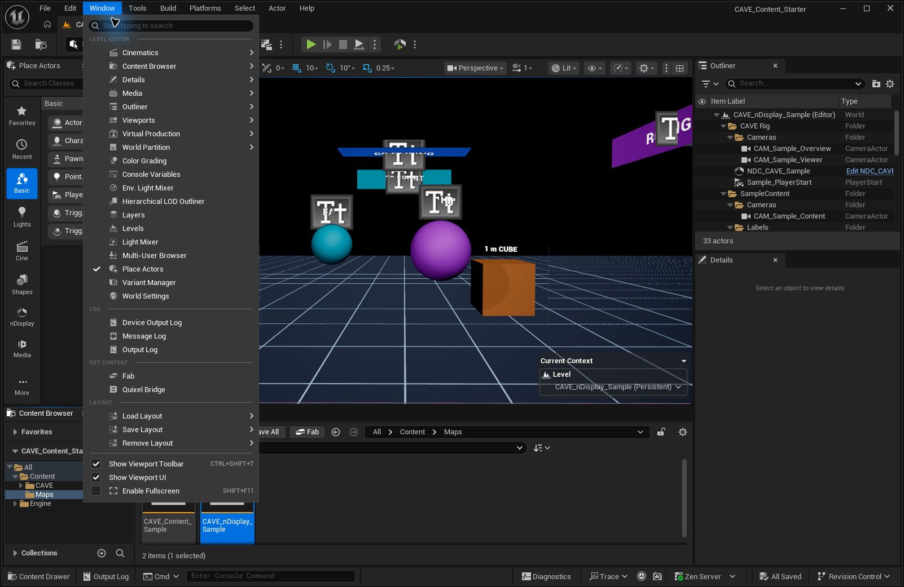

*상단 Window 메뉴의 Levels 항목을 누릅니다.*

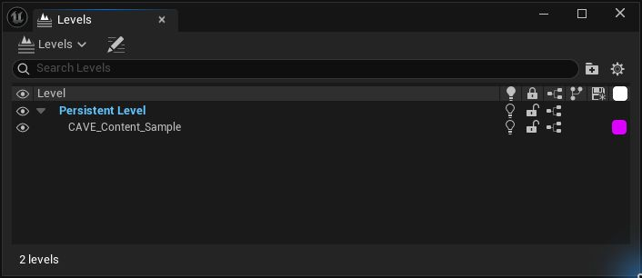

*Persistent Level은 현재 연 실행용 레벨입니다. 그 아래의 CAVE_Content_Sample이 함께 불러오는 콘텐츠입니다.*

실행용 레벨을 열어 둔 상태에서도 콘텐츠를 편집할 수 있습니다. 기존 오브젝트를 수정하면 그 오브젝트가 들어 있는 레벨 파일에 저장됩니다. **새 오브젝트를 콘텐츠 파일에 추가하려면**, Levels 창에서 `CAVE_Content_Sample`을 우클릭하고 **Make Current**를 선택합니다. 이후 추가하는 오브젝트가 이 콘텐츠 파일에 저장됩니다.

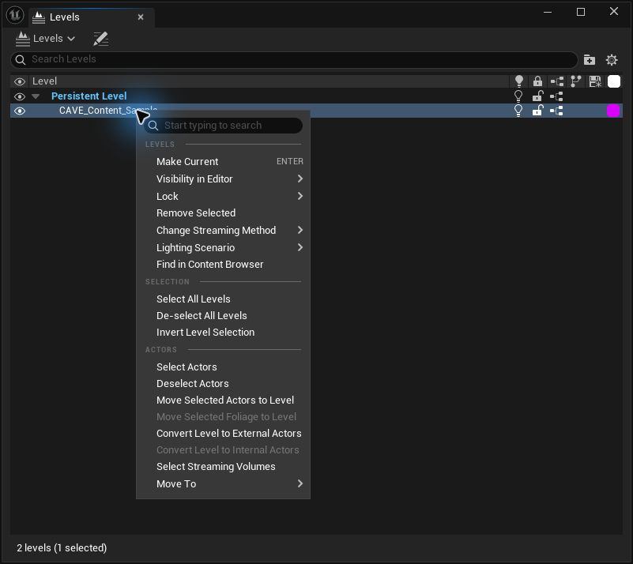

*Make Current는 새 오브젝트를 넣을 레벨을 지정합니다. 기존 오브젝트를 다른 레벨로 옮기는 기능은 아닙니다. [Unreal Engine 레벨 관리 문서](https://dev.epicgames.com/documentation/en-us/unreal-engine/managing-multiple-levels-in-unreal-engine)*

### Outliner의 구성

Outliner는 현재 장면에 놓인 오브젝트, 조명, 카메라를 보여 주는 목록입니다. Unreal에서는 이런 장면 구성 요소를 **액터**(Actor)라고 부릅니다. 실행용 레벨에서는 화면 배치를 담당하는 `CAVERig`와 콘텐츠를 담은 `SampleContent`가 함께 표시됩니다. Outliner의 폴더는 목록을 정리하는 용도이며, 어느 레벨 파일에 저장되는지는 **Levels**에서 확인합니다.

| 항목 | 역할 |
| --- | --- |
| `CAVERig > NDC_CAVE_Sample` | CAVE 화면 배치를 장면에 놓은 오브젝트입니다. 각 화면에 콘텐츠가 어떻게 보이는지 미리 확인합니다. Unreal에서는 이 오브젝트를 **nDisplay Root Actor**라고 부릅니다. |
| `CAVERig > Cameras` | `CAM_Sample_Overview`는 전체 구조, `CAM_Sample_Viewer`는 관람 위치에서 장면을 확인하는 참고 카메라입니다. |
| `CAVERig > Sample_PlayerStart` | 플레이어가 생성될 때 사용할 시작 위치입니다. |
| `SampleContent` | 콘텐츠 레벨의 오브젝트, 조명, 기준 격자와 방향 표식입니다. |

실제 출력 화면은 `CAVE_ViewOrigin`에 지정한 눈 위치를 기준으로 계산합니다. 이 프로젝트의 기본 눈 위치는 바닥에서 160cm 높이입니다. `Cameras` 폴더의 카메라는 에디터에서 장면을 둘러보기 위한 것이므로, 이 카메라를 움직여도 실제 출력의 눈 위치는 그대로 유지됩니다.

## 콘텐츠 제작하기

### 콘텐츠 레벨 편집

1. **Content Browser > Content > Maps**에서 `CAVE_Content_Sample`을 엽니다.
2. **Outliner > SampleContent > Objects**를 펼쳐 `Sample_Cube_1m`을 선택합니다. 중앙 장면에서 큐브를 클릭해도 됩니다.
3. **Details > Transform**에서 **Location**으로 위치, **Rotation**으로 회전, **Scale**로 크기 비율을 수정합니다. 각 항목의 세 값은 왼쪽부터 X, Y, Z입니다.
4. 표면의 색상이나 질감을 바꾸려면 **Materials**에 지정된 **머티리얼**(Material)을 수정하거나 다른 머티리얼로 교체합니다.
5. 작업이 끝나면 Content Browser 상단의 **Save All**을 눌러 저장합니다.

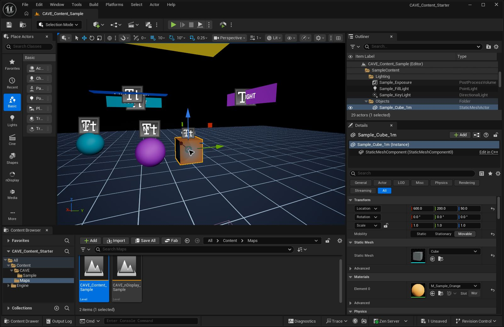

*오른쪽 Details에서 위치·회전·크기와 재질을 확인합니다. 아래쪽 Save All은 변경한 파일을 저장하는 버튼입니다. 사진의 큐브는 위치 (600, 200, 50)cm, 크기 비율 (1, 1, 1)입니다.*

외부 모델을 가져올 때는 Content Browser의 **Import**를 누릅니다. 가져온 모델 에셋을 중앙 장면으로 끌어놓아 배치합니다.

`Objects`에는 큐브와 구체, `Lighting`에는 조명과 노출 설정이 있습니다. `Labels`는 크기와 거리 설명, `OutputMarkers`는 출력 방향을 확인하는 글자와 색상판입니다. `ScaleReference`에는 1m 간격의 기준 격자가 있습니다. Outliner에서 작업할 폴더만 펼쳐 사용합니다.

### 좌표와 크기 기준

콘텐츠의 위치와 CAVE 화면의 위치는 같은 기준으로 지정합니다. 모델을 가져올 때 단위와 크기를 확인하고, 다음 위치 기준에 맞춰 배치합니다.

| 항목 | 기준값 |
| --- | --- |
| 월드 단위 | 1 Unreal unit = 1cm |
| 축 방향 | +X 정면, -X 후면, -Y 왼쪽, +Y 오른쪽, +Z 위 |
| CAVE 원점 | `(0, 0, 0)` |
| 기본 관람 위치 | `CAVE_ViewOrigin`, `(0, 0, 160)`cm |
| 정면과 후면 위치 | X = +480cm, -480cm |
| 좌우 벽 위치 | Y = -240cm, +240cm |
| 벽과 천장 높이 | 벽 Z = 0~270cm, 천장 Z = 270cm |
| 설정에 정의된 화면 하나의 크기 | 480 × 270cm |

격자 바닥은 장면 안의 가상 콘텐츠입니다. 실제 출력면은 정면, 좌우, 후면, 천장으로 구성되며 바닥 출력은 없습니다.

### 새 작품용 레벨 만들기

샘플과 분리해 작품을 제작하려면 콘텐츠 레벨과 실행 레벨을 함께 복제합니다.

1. **Content Browser > Content > Maps**에서 `CAVE_Content_Sample`을 우클릭하고 **Duplicate**를 선택합니다. 새 이름을 `My_Content`로 입력합니다.
2. 같은 방법으로 `CAVE_nDisplay_Sample`을 복제하고 `My_CAVE`로 이름을 지정합니다.

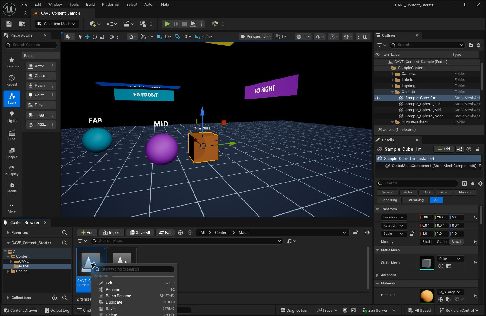

*레벨 파일을 우클릭하면 메뉴 아래쪽에 Duplicate가 있습니다. My_Content와 My_CAVE는 작품용 파일 이름의 예시입니다.*

3. `My_CAVE`를 열고 **Window > Levels**를 선택합니다. 복제 직후에는 기존 `CAVE_Content_Sample`이 연결되어 있습니다.
4. Levels 창의 `CAVE_Content_Sample`을 우클릭하고 **Remove Selected**로 연결을 해제합니다. 이 작업은 실행 레벨에서의 연결만 제거하며, Content Browser의 원본 파일은 유지됩니다.
5. Levels 창 왼쪽 위의 **Levels > Add Existing**을 누르고 `My_Content`를 선택합니다.

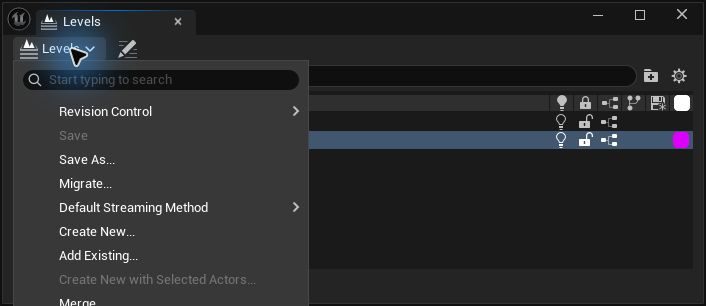

*Add Existing은 이미 저장된 콘텐츠 레벨을 현재 실행 레벨에 연결합니다.*

6. 추가한 `My_Content`를 우클릭하고 **Change Streaming Method > Always Loaded**를 선택합니다. 실행할 때 이 콘텐츠를 항상 불러오도록 하는 설정입니다.
7. 추가한 레벨의 위치와 회전은 기본값인 0을 유지하고 **Save All**로 저장합니다.

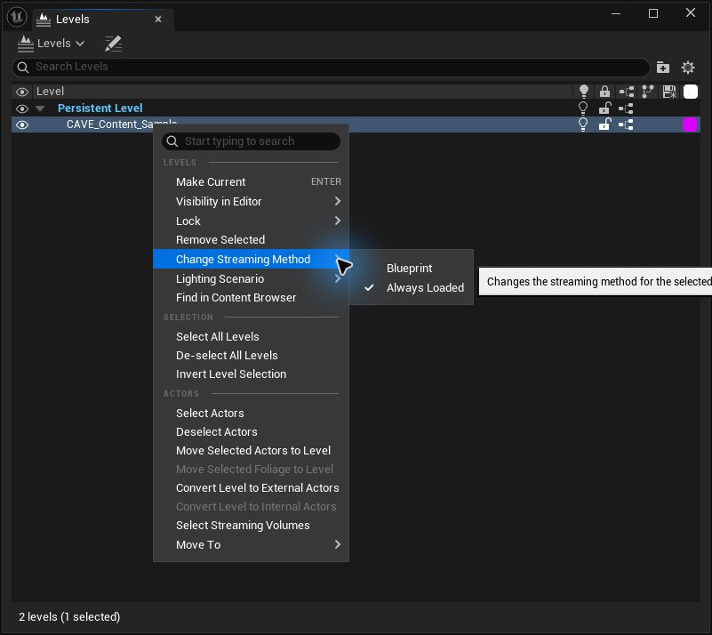

*사진은 샘플의 연결 설정입니다. 새 작품에서는 My_Content에 같은 설정을 적용합니다. Always Loaded 왼쪽에 체크 표시가 있으면 적용된 상태입니다.*

이후 `My_Content`에서 제작하고, `My_CAVE`를 열어 출력 결과를 확인하고 실행합니다.

## CAVE 화면에서 확인하기

nDisplay는 관람자의 눈 위치와 각 화면의 위치를 기준으로 화면마다 보여 줄 장면을 계산합니다. 정면, 옆면, 천장에서 콘텐츠가 이어져 보이도록 하려면 실제 CAVE의 화면 배치와 눈 위치에 맞게 설정해야 합니다. [Unreal Engine nDisplay 개요](https://dev.epicgames.com/documentation/en-us/unreal-engine/ndisplay-overview-for-unreal-engine)

1. 콘텐츠 레벨을 저장하고 `CAVE_nDisplay_Sample` 또는 작품의 실행 레벨을 엽니다.
2. 중앙 뷰포트 위쪽의 **Perspective 또는 카메라 이름이 표시된 메뉴**를 열고 `CAM_Sample_Overview`를 선택합니다. CAVE 전체 구조를 보는 참고 시점으로 바뀝니다.

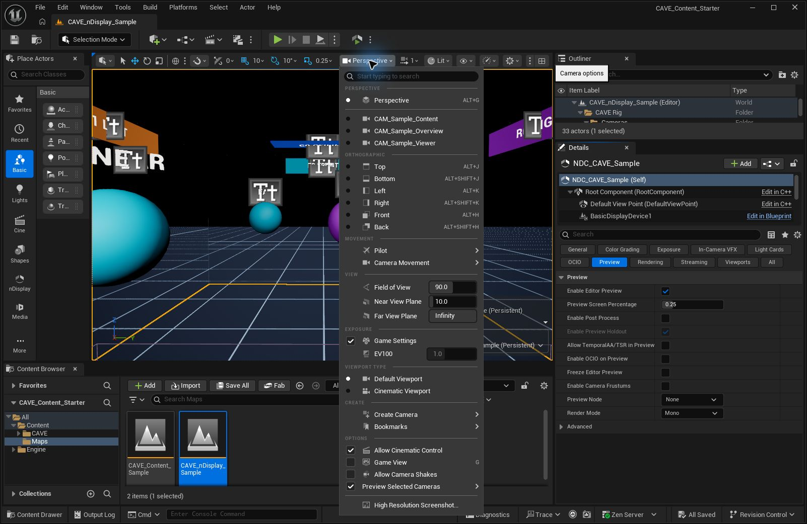

*CAM_Sample_Overview는 전체 구조를 보는 참고 카메라입니다. 관람 위치에서 장면을 살펴볼 때는 CAM_Sample_Viewer를 선택할 수 있습니다.*

3. **Outliner > CAVERig > NDC_CAVE_Sample**을 선택합니다.
4. **Details > Preview**에서 **Enable Editor Preview**를 켜고, **Freeze Editor Preview**는 해제합니다. 화면 배치에 투영된 콘텐츠가 갱신됩니다.
5. 각 화면에 오브젝트가 어떻게 보이는지 확인합니다. 벽과 천장 경계에서 장면이 이어지는지도 확인합니다.

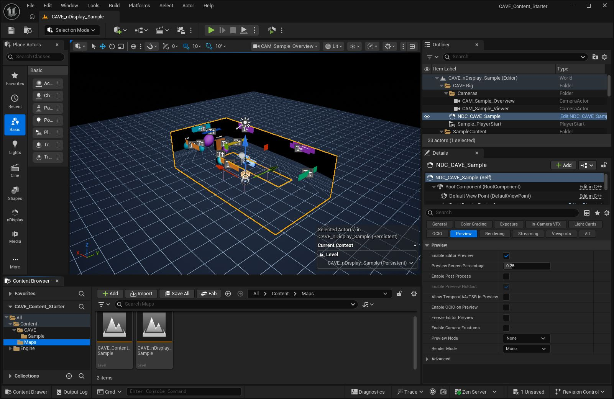

*오른쪽 Preview 탭에서 Enable Editor Preview와 Freeze Editor Preview를 확인합니다. 왼쪽은 실행 레벨에서 화면 배치와 콘텐츠를 함께 보는 모습입니다.*

에디터 미리보기의 선명도는 **Preview Screen Percentage**로 조정합니다. 사진의 값은 `0.25`입니다. 이 값은 미리보기 품질에 적용되며, 실제 CAVE 출력 해상도는 [nDisplay 설정하기](#ndisplay-설정하기)에서 지정합니다. [nDisplay 미리보기 설정 문서](https://dev.epicgames.com/documentation/en-us/unreal-engine/ndisplay-root-actor-reference-for-unreal-engine)


*8개 출력 화면을 4열과 2행으로 모은 참고 이미지입니다. 위 행은 L0, L1, F0, R0이고, 아래 행은 R1, B0, C0, C1입니다. 실제 장비에서는 각 이미지가 지정된 CAVE 화면에 표시됩니다.*

## nDisplay 설정하기

화면 배치와 출력 노드는 `NDC_CAVE_Sample` 구성 에셋에 저장됩니다. 콘텐츠를 교체할 때는 이 구성을 유지하고, 물리 화면 배치나 출력 장비가 바뀔 때 필요한 설정을 조정합니다.

**Content Browser > Content > CAVE > Sample**에서 `NDC_CAVE_Sample`을 열면 **nDisplay 3D Config Editor**가 표시됩니다.

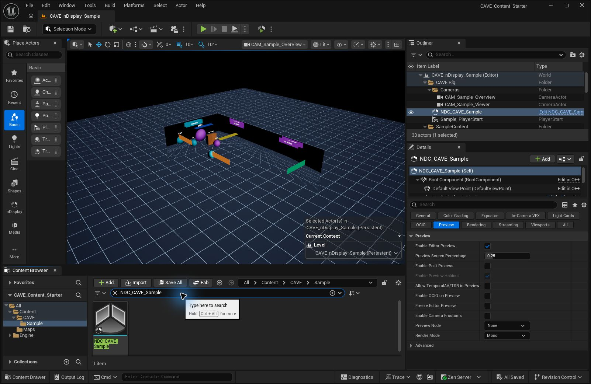

*Sample 폴더의 검색창에 NDC_CAVE_Sample을 입력한 모습입니다. 화면 모양 아이콘의 구성 에셋을 더블클릭합니다.*

이 설정에서 **노드**(Node)는 화면 출력을 위해 별도로 실행할 Unreal 프로그램 하나를 뜻합니다. **뷰포트**(Viewport)는 그 프로그램의 출력 창 안에서 영상을 그릴 영역입니다. 이 프로젝트는 노드 8개가 각각 뷰포트 하나를 출력합니다.

| 영역 | 설정하는 내용 |
| --- | --- |
| Components | CAVE 안에서 각 화면을 놓을 위치와 방향, 화면 크기, 관람자의 눈 위치 |
| Cluster | 화면을 출력할 노드의 주소, 사용할 그래픽카드, 노드별 뷰포트 |
| Output Mapping | Windows 바탕화면에서 출력 창을 놓을 위치와 창 안의 영상 영역 |

화면의 공간 배치는 **Components**, Windows 데스크톱에 놓일 출력 창의 배치는 **Cluster와 Output Mapping**에서 설정합니다. [nDisplay 구성 에디터 문서](https://dev.epicgames.com/documentation/unreal-engine/ndisplay-3d-config-editor-in-unreal-engine)

### 화면과 관람 기준점 수정

**관람자의 눈 위치**를 바꾸려면 **Components > cave_origin > CAVE_ViewOrigin**을 선택합니다. 오른쪽 **Details > Transform > Location**에 위치를 입력합니다. 기본값은 `(0, 0, 160)`cm입니다.

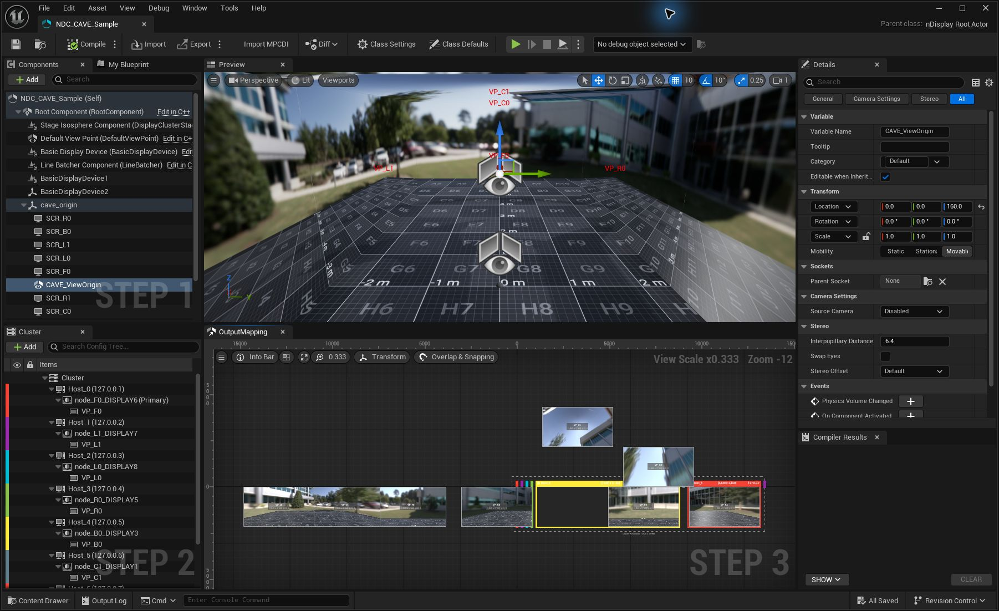

*왼쪽 위는 Components, 왼쪽 아래는 Cluster, 가운데 아래는 Output Mapping입니다. 오른쪽 Location의 Z 값 160은 바닥에서 눈까지의 높이입니다. 가운데 건물 배경은 구성 에디터의 프리뷰 환경이며, 콘텐츠 레벨의 장면은 실행 레벨에서 확인합니다.*

**화면의 공간 배치**를 바꾸려면 같은 Components에서 `SCR_*`를 선택합니다. `SCR_F0`는 정면 화면입니다. **Transform**의 위치·회전·크기를 실제 장비에 맞게 수정합니다.

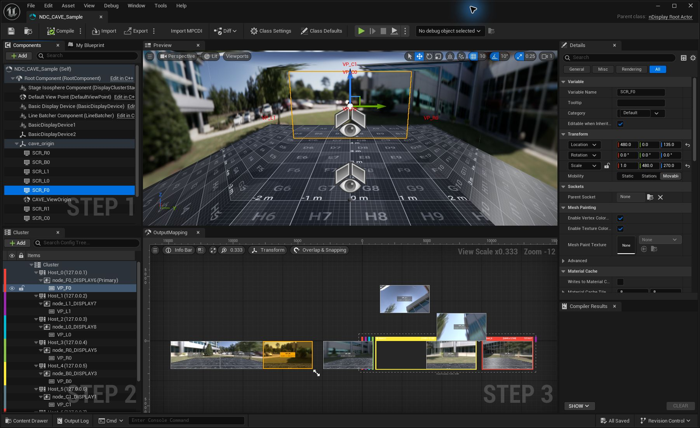

*SCR_F0를 선택하면 오른쪽 Transform에 위치와 크기가 표시됩니다. 이 샘플의 Location은 (480, 0, 135), Scale은 (1, 480, 270)입니다. 이 설정은 공간 안의 화면 배치이며, 픽셀 단위 출력 해상도는 아래 Region에서 지정합니다.*

**영상과 화면의 연결**은 **Cluster**에서 노드 아래의 `VP_*`를 선택해 확인합니다. 예를 들어 `node_F0_DISPLAY6 > VP_F0`를 선택하고 오른쪽 **Configuration** 탭을 엽니다.

| 설정 | 이 샘플의 VP_F0 값 | 의미 |
| --- | --- | --- |
| View Point | `CAVE_ViewOrigin` | 영상을 계산할 때 기준으로 삼는 눈 위치 |
| Projection Policy > Type | `Mesh` | 지정한 화면 구성 요소에 영상을 투영하는 방식 |
| Projection Policy > Mesh | `SCR_F0` | 영상을 표시할 정면 화면 |
| Region > Position | `(0, 0)` | 출력 창 안에서 영상이 시작하는 위치 |
| Region > Size | `(3840, 2160)` | 출력 창 안에 그릴 영상의 너비와 높이, 단위는 px |

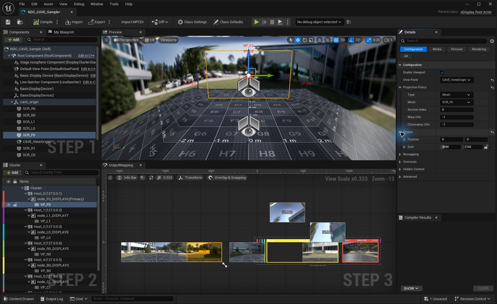

*오른쪽 Configuration에서 눈 위치, 투영할 화면, 영상 영역을 확인합니다. SCR_* 항목의 이름을 바꾸면 이 연결 설정도 함께 수정합니다.*

### 출력 노드 수정 및 저장

1. **Cluster**에서 수정할 노드를 선택합니다.
2. **Details**의 **All** 탭을 선택하고, **Network > Host IP Address**에 실행할 PC의 주소를 지정합니다.
3. **Configuration > Window > Position**에 Windows 바탕화면에서 출력 창을 놓을 좌표, **Size**에 창 크기를 입력합니다. **Graphics Adapter**에는 사용할 그래픽카드 번호를 지정합니다.
4. 노드 아래의 뷰포트를 선택해 앞서 설명한 **Region**과 **Projection Policy**도 확인합니다.

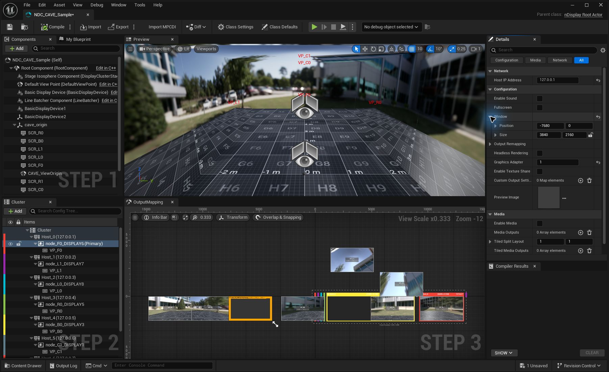

*정면 노드의 Window Position은 (-7680, 0), Size는 (3840, 2160), Graphics Adapter는 1입니다. 다른 노드의 값은 아래 출력 대상 표에서 확인합니다.*

5. 구성 에디터 왼쪽 위의 디스크 모양 **Save** 버튼으로 구성 에셋을 저장합니다.
6. 내보낸 설정 파일도 전달하거나 사용할 경우, 상단 **Export**를 누르고 `Content/CAVE/Sample/NDC_CAVE_Sample.ndisplay`에 저장합니다.

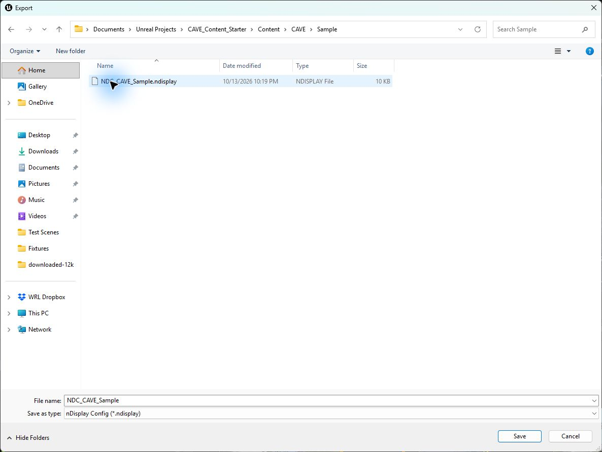

*파일 형식이 nDisplay Config이고 확장자가 .ndisplay인지 확인합니다. 설정을 바꾼 뒤 기존 파일을 갱신할 때도 같은 위치로 Export합니다.*

구성 에셋을 저장해도 이전에 Export한 `.ndisplay` 파일은 자동 갱신되지 않습니다. 이 문서의 에디터 실행은 레벨에 배치한 `NDC_CAVE_Sample`의 구성을 사용합니다. `.ndisplay`는 출력 설정 파일이며 콘텐츠 레벨과 머티리얼은 프로젝트의 별도 에셋으로 관리합니다.

### 출력 대상

제공된 `.ndisplay` 파일의 설정은 다음과 같습니다. 각 노드는 화면 하나를 **3840 × 2160px**로 출력합니다. GPU 열은 사용할 그래픽카드 번호이며, 설정 파일의 `graphicsAdapter` 값에 해당합니다.

| 출력면 | 노드 | 주소 | GPU | 창 X | 창 Y |
| --- | --- | --- | ---: | ---: | ---: |
| F0 정면 | node_F0_DISPLAY6 | 127.0.0.1 | 1 | -7680 | 0 |
| L1 왼쪽 앞 | node_L1_DISPLAY7 | 127.0.0.2 | 1 | -11520 | 0 |
| L0 왼쪽 뒤 | node_L0_DISPLAY8 | 127.0.0.3 | 1 | -15360 | 0 |
| R0 오른쪽 앞 | node_R0_DISPLAY5 | 127.0.0.4 | 1 | -3840 | 0 |
| B0 후면 | node_B0_DISPLAY3 | 127.0.0.5 | 0 | 3840 | 0 |
| C1 천장 뒤 | node_C1_DISPLAY1 | 127.0.0.6 | 0 | -7680 | -4320 |
| R1 오른쪽 뒤 | node_R1_DISPLAY4 | 127.0.0.7 | 0 | 0 | 0 |
| C0 천장 앞 | node_C0_DISPLAY2 | 127.0.0.8 | 0 | -7680 | -2160 |

표의 `127.0.0.*` 주소들은 모두 현재 PC를 가리킵니다. 이런 주소를 **루프백 주소**라고 부릅니다. 여러 노드의 기준이 되는 **Primary Node**는 `node_F0_DISPLAY6`입니다.

노드명의 `DISPLAY` 숫자는 Windows 모니터 번호와 다를 수 있습니다. 출력 대상은 실제 화면 역할, GPU, 데스크톱 창 좌표를 기준으로 확인합니다. 모니터 배치나 화면 배율이 바뀌면 창 위치와 크기도 다시 확인합니다.

**L0는 3840 × 2160 전체를 렌더한 뒤 LED에서 우측 절반인 x = 1920~3839를 사용합니다.** 전체 영상을 절반 너비로 축소하지 않습니다. L0에 필요한 콘텐츠와 표식은 이 활성 영역에 배치합니다. 후면의 `B0`는 현장 명칭 `R3`에 해당합니다.

## CAVE 출력 실행하기

이 프로젝트는 한 PC에서 8개 nDisplay 노드를 실행합니다. 에디터에 이미 활성화된 **nDisplay Launch**를 사용합니다.

### 실행할 구성 선택

1. **Save All**로 콘텐츠 레벨과 nDisplay 구성 에셋을 저장합니다.
2. **Content Browser > Content > Maps**에서 `CAVE_nDisplay_Sample`을 엽니다. 작품용 레벨을 만들었다면 `My_CAVE`를 엽니다.
3. 상단 툴바의 **nDisplay Launch** 옆 **세 점(⋮)** 메뉴를 열고, **Configuration** 아래의 `NDC_CAVE_Sample`을 선택합니다.

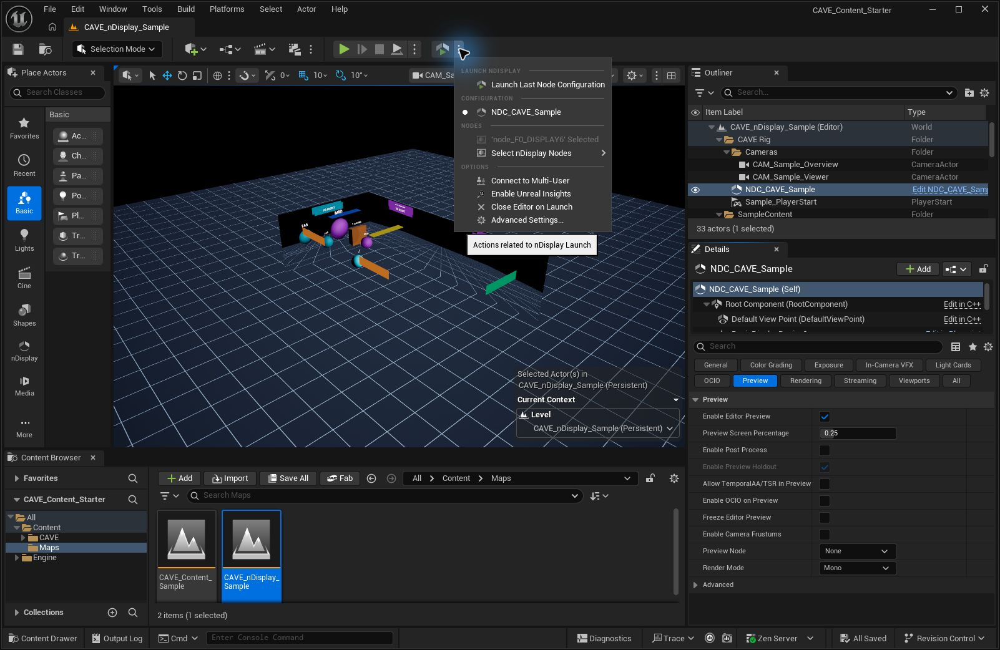

*Configuration 아래에 현재 레벨에 배치된 NDC_CAVE_Sample이 표시됩니다. 선택한 구성 왼쪽에 표시가 생깁니다.*

### 출력 노드와 기준 노드 선택

4. 같은 메뉴의 **Nodes > Select nDisplay Nodes**를 열고 8개 노드를 모두 선택합니다. 선택된 노드에는 체크 표시가 생기며, 메뉴에 **Selected 8 Nodes**로 표시됩니다.

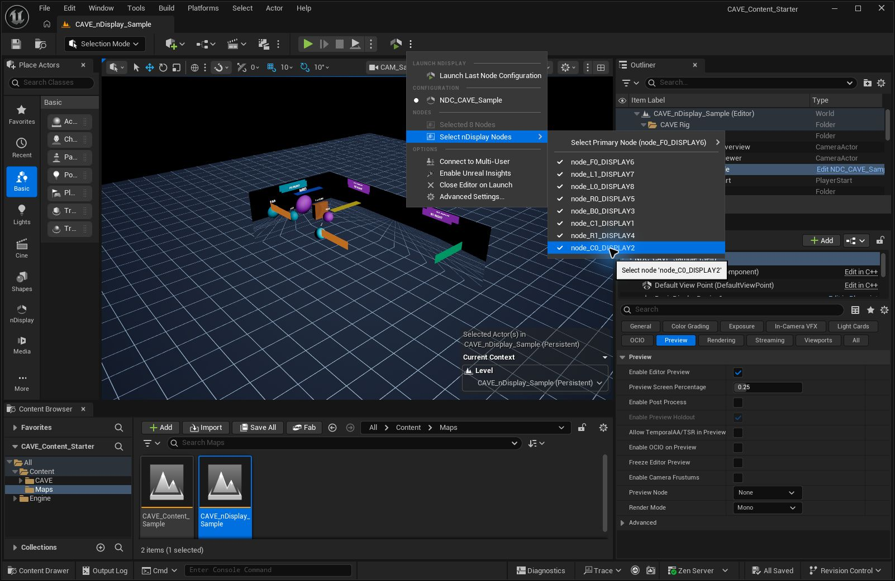

*체크한 노드마다 Unreal 출력 프로그램 하나가 실행됩니다. 이 구성에서는 8개 노드가 각각 화면 하나를 담당합니다.*

5. **Select Primary Node**에서 `node_F0_DISPLAY6`를 선택합니다. 여러 노드가 함께 실행될 때 기준이 되는 노드입니다.

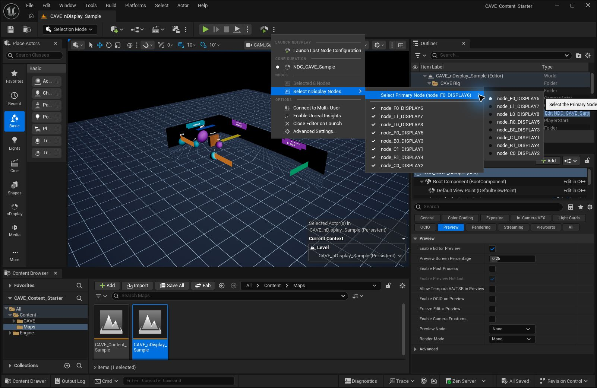

*오른쪽 목록에서 node_F0_DISPLAY6 왼쪽의 선택 표시를 확인합니다.*

### 시작과 종료

6. 메뉴를 닫고 **세 점(⋮) 바로 왼쪽의 nDisplay Launch 아이콘**을 누릅니다. 선택한 노드가 실행되면 구성에 지정된 위치에 출력 창이 나타납니다.
7. 정면, 좌우, 후면, 천장의 방향 표식과 화면 경계가 올바르게 이어지는지 확인합니다.
8. 종료할 때는 에디터 툴바의 같은 위치에 표시되는 **정지 아이콘**을 누릅니다.

출력 창은 위 표의 위치와 해상도로 열립니다. 해당 화면이 연결되어 있지 않은 PC에서는 일부 창이 화면 밖에 놓일 수 있습니다. 콘텐츠를 수정한 뒤에는 저장하고 출력을 다시 실행합니다. [Unreal Engine nDisplay Launch 사용법](https://dev.epicgames.com/documentation/en-us/unreal-engine/ndisplay-quick-launch-local-tool-in-unreal-engine)
