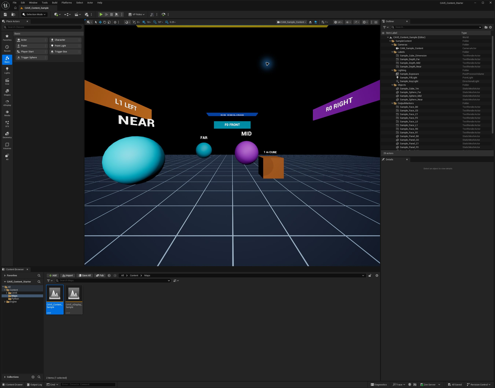
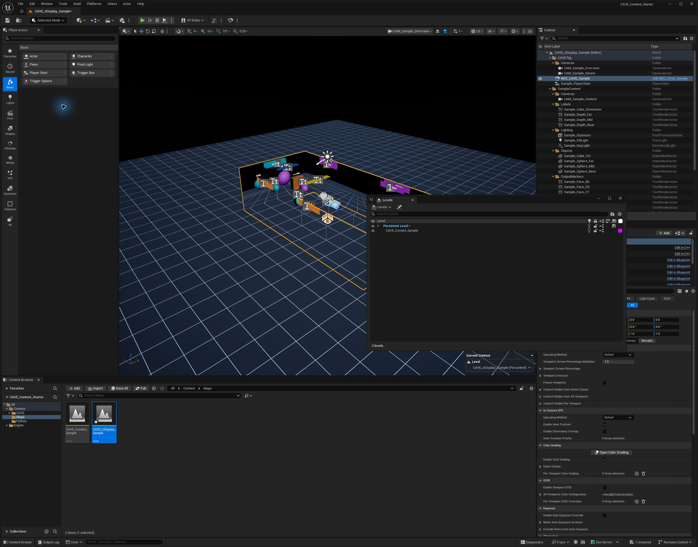
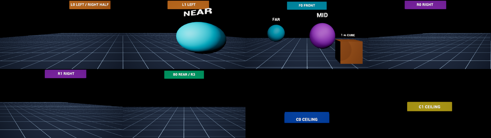
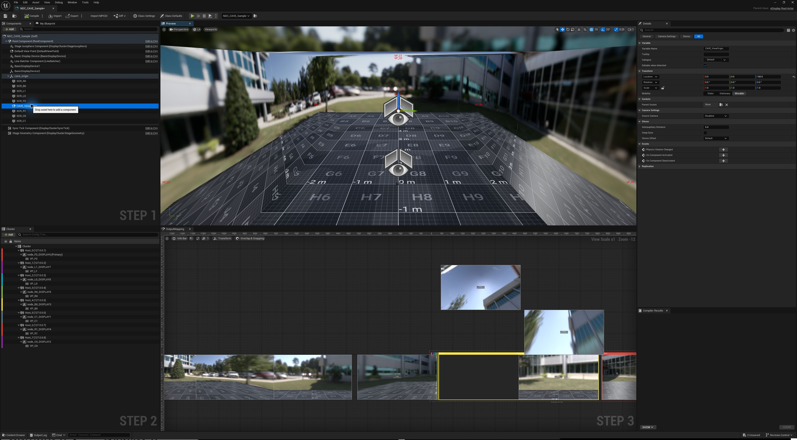
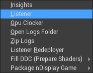
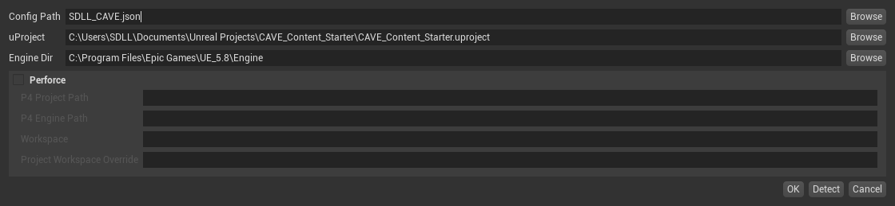
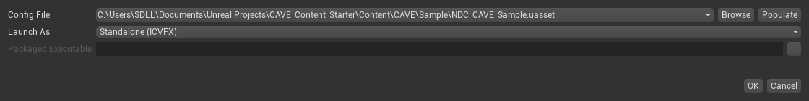
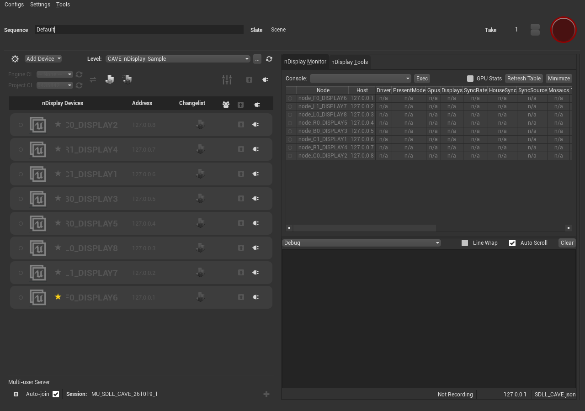

# SDLL CAVE 콘텐츠 제작 및 실행

`CAVE_Content_Starter`는 Unreal Engine에서 SDLL CAVE용 콘텐츠를 제작하고 여러 화면에 출력하기 위한 프로젝트입니다. 정면, 왼쪽, 오른쪽, 후면, 천장의 5개 면에 8개 화면을 출력합니다. 여러 화면에 맞춰 장면을 그리는 Unreal 기능인 **nDisplay**를 사용합니다.

콘텐츠는 `CAVE_Content_Sample`에서 제작합니다. `CAVE_nDisplay_Sample`에서 콘텐츠를 CAVE 화면 배치와 함께 확인한 뒤, Switchboard로 현장 출력을 실행합니다. 이 문서는 프로젝트 열기부터 레벨 편집, nDisplay 설정, 현장 실행까지의 절차를 안내합니다.

- [프로젝트 열기](#프로젝트-열기)
- [프로젝트 구성 이해하기](#프로젝트-구성-이해하기)
- [콘텐츠 제작하기](#콘텐츠-제작하기)
- [CAVE 화면에서 확인하기](#cave-화면에서-확인하기)
- [nDisplay 설정하기](#ndisplay-설정하기)
- [Switchboard로 실행하기](#switchboard로-실행하기)

## 프로젝트 열기

프로젝트의 기준 환경은 **Unreal Engine 5.8.3, Windows, DirectX 12**입니다. 필요한 nDisplay와 Switchboard 기능은 프로젝트에 이미 켜져 있습니다.

### Git에서 내려받기

Git과 Git LFS를 설치한 뒤, 프로젝트를 저장할 폴더에서 PowerShell을 열고 다음 명령을 실행합니다.

```powershell
git lfs install
git clone https://github.com/wrlab/sdll-unreal-sample.git CAVE_Content_Starter
cd CAVE_Content_Starter
git lfs pull
```

장면과 설정을 저장하는 Unreal 파일인 `.umap`과 `.uasset`은 Git LFS로 관리됩니다. `git lfs pull`이 완료되면 이 파일들의 다운로드가 끝납니다.

### Unreal Editor에서 열기

1. `CAVE_Content_Starter.uproject`를 Unreal Engine 5.8.3으로 엽니다.
2. 화면에 사용할 재질과 효과를 준비하는 **셰이더 컴파일**이 끝날 때까지 기다립니다.
3. 시작 레벨인 `CAVE_Content_Sample`에서 격자, 큐브, 구체를 확인합니다.

다른 레벨이 열려 있다면 **Content Browser > Content > Maps**에서 `CAVE_Content_Sample`을 엽니다.

에디터에서는 다음 세 창을 주로 사용합니다.

| 창 | 사용하는 때 |
| --- | --- |
| Content Browser | 프로젝트에 저장된 장면 파일, 모델, 재질, 설정 파일을 찾고 엽니다. |
| Outliner | 현재 열린 장면의 오브젝트, 조명, 카메라를 목록에서 선택합니다. |
| Details | 선택한 항목의 위치, 크기와 설정값을 확인하고 수정합니다. |

## 프로젝트 구성 이해하기

### 주요 파일의 역할

Unreal에서 **레벨(Level)**은 오브젝트와 조명을 배치한 장면을 저장하는 파일입니다. **에셋(Asset)**은 프로젝트에서 사용하는 모델, 재질, 설정 파일 같은 자료를 뜻합니다.

| 이름 | 형식 | 역할 |
| --- | --- | --- |
| `CAVE_Content_Sample` | 레벨 `.umap` | **SDLL용 콘텐츠 제작을 위한 레벨**입니다. 오브젝트, 조명, 연출을 배치하고 수정합니다. |
| `CAVE_nDisplay_Sample` | 레벨 `.umap` | 제작한 콘텐츠가 CAVE의 각 화면에 어떻게 보이는지 확인하고 실행하는 레벨입니다. |
| `NDC_CAVE_Sample` | nDisplay 구성 에셋 `.uasset` | CAVE 화면의 위치와 크기, 관람자의 눈 위치, 화면별 출력 방법을 저장한 설정 파일입니다. |
| `NDC_CAVE_Sample.ndisplay` | 내보낸 설정 파일 | 위 구성 에셋에서 **Export** 기능으로 만든 파일입니다. Switchboard에서 사용할 수 있습니다. |

제작과 실행에 사용하는 주요 파일은 다음 위치에 있습니다.

```text
CAVE_Content_Starter/
├─ CAVE_Content_Starter.uproject
├─ Config/                         # 프로젝트와 렌더링 설정
├─ Content/
│  ├─ Maps/
│  │  ├─ CAVE_Content_Sample.umap
│  │  └─ CAVE_nDisplay_Sample.umap
│  └─ CAVE/Sample/
│     ├─ NDC_CAVE_Sample.uasset
│     ├─ NDC_CAVE_Sample.ndisplay
│     └─ M_Sample_*.uasset          # 샘플 오브젝트의 색상과 표면 재질
├─ Preview/                        # 문서에 사용하는 이미지
└─ README.md
```

### 두 레벨의 연결 방식

`CAVE_Content_Sample`에서 콘텐츠를 만들고 저장한 뒤, `CAVE_nDisplay_Sample`을 열어 CAVE 화면 배치와 함께 확인합니다. 실행용 파일인 `CAVE_nDisplay_Sample`이 제작용 파일인 `CAVE_Content_Sample`을 함께 불러오도록 연결되어 있기 때문입니다.

예를 들어 제작용 파일에서 큐브를 위로 옮기고 저장하면, 실행용 파일을 열었을 때도 그 큐브가 옮긴 위치에 나타납니다. 실행용 파일은 같은 콘텐츠 원본을 불러오므로, 수정할 때마다 콘텐츠를 다시 복사할 필요가 없습니다.

```text
CAVE_nDisplay_Sample
├─ CAVERig                    CAVE 화면 배치를 담당하는 오브젝트
└─ CAVE_Content_Sample        함께 불러오는 콘텐츠 파일
   └─ SampleContent          콘텐츠 오브젝트와 조명
```

Unreal의 **Levels** 창에서는 실행용 레벨을 **Persistent Level**로 표시하며, 함께 불러온 콘텐츠 레벨을 **서브레벨**이라고 부릅니다. 이 프로젝트의 **Always Loaded** 설정은 실행할 때 콘텐츠 레벨을 항상 함께 불러오도록 합니다.

실행용 레벨을 열어 둔 상태에서도 콘텐츠를 편집할 수 있습니다. 기존 오브젝트를 수정하면 그 오브젝트가 들어 있는 레벨 파일에 저장됩니다. 새 오브젝트를 콘텐츠 파일에 추가하려면 **Window > Levels**에서 `CAVE_Content_Sample`을 우클릭하고 **Make Current**를 선택합니다. 이렇게 지정하면 이후 추가하는 오브젝트가 콘텐츠 파일에 저장됩니다. [Unreal Engine 레벨 관리 문서](https://dev.epicgames.com/documentation/en-us/unreal-engine/managing-multiple-levels-in-unreal-engine)

### Outliner의 구성

Outliner는 현재 장면에 놓인 오브젝트, 조명, 카메라를 보여 주는 목록입니다. Unreal에서는 이런 장면 구성 요소를 **액터(Actor)**라고 부릅니다. 실행용 레벨에서는 화면 배치를 담당하는 `CAVERig`와 콘텐츠를 담은 `SampleContent`가 함께 표시됩니다. Outliner의 폴더는 목록을 정리하는 용도이며, 어느 레벨 파일에 저장되는지는 **Levels**에서 확인합니다.

| 항목 | 역할 |
| --- | --- |
| `CAVERig > NDC_CAVE_Sample` | CAVE 화면 배치를 장면에 놓은 오브젝트입니다. 각 화면에 콘텐츠가 어떻게 보이는지 미리 확인합니다. Unreal에서는 이 오브젝트를 **nDisplay Root Actor**라고 부릅니다. |
| `CAVERig > Cameras` | `CAM_Sample_Overview`는 전체 구조, `CAM_Sample_Viewer`는 관람 위치에서 장면을 확인하는 참고 카메라입니다. |
| `CAVERig > Sample_PlayerStart` | 플레이어가 생성될 때 사용할 시작 위치입니다. |
| `SampleContent` | 콘텐츠 레벨의 오브젝트, 조명, 기준 격자와 방향 표식입니다. |

실제 출력 화면은 `CAVE_ViewOrigin`에 지정한 눈 위치를 기준으로 계산합니다. 이 프로젝트의 기본 눈 위치는 바닥에서 160cm 높이입니다. `Cameras` 폴더의 카메라는 에디터에서 장면을 둘러보기 위한 것이므로, 이 카메라를 움직여도 실제 출력의 눈 위치는 그대로 유지됩니다.

## 콘텐츠 제작하기

### 콘텐츠 레벨 편집

1. **Content Browser > Content > Maps**에서 `CAVE_Content_Sample`을 엽니다.
2. **Outliner > SampleContent**에서 작업할 폴더를 펼칩니다.
3. 오브젝트를 추가하거나 **Details**에서 위치와 크기를 수정합니다. 표면의 색상이나 질감을 바꾸려면 해당 오브젝트에 지정된 **머티리얼(Material)**을 수정합니다.
4. 조명과 연출을 조정한 뒤 레벨을 저장합니다.

`Objects`에는 큐브와 구체, `Lighting`에는 조명과 노출 설정이 있습니다. `Labels`는 크기와 거리 설명, `OutputMarkers`는 출력 방향을 확인하는 글자와 색상판입니다. `ScaleReference`에는 1m 간격의 기준 격자가 있습니다.



*콘텐츠 레벨을 참고 카메라로 본 화면입니다. 격자와 기본 도형으로 모델의 크기, 거리감, 배치 방향을 확인할 수 있습니다.*

### 좌표와 크기 기준

콘텐츠의 위치와 CAVE 화면의 위치는 같은 기준으로 지정합니다. 모델을 가져올 때 단위와 크기를 확인하고, 다음 위치 기준에 맞춰 배치합니다.

| 항목 | 기준값 |
| --- | --- |
| 월드 단위 | 1 Unreal unit = 1cm |
| 축 방향 | +X 정면, -X 후면, -Y 왼쪽, +Y 오른쪽, +Z 위 |
| CAVE 원점 | `(0, 0, 0)` |
| 기본 관람 위치 | `CAVE_ViewOrigin`, `(0, 0, 160)`cm |
| 정면과 후면 위치 | X = +480cm, -480cm |
| 좌우 벽 위치 | Y = -240cm, +240cm |
| 벽과 천장 높이 | 벽 Z = 0~270cm, 천장 Z = 270cm |
| 설정에 정의된 화면 하나의 크기 | 480 × 270cm |

격자 바닥은 장면 안의 가상 콘텐츠입니다. 실제 출력면은 정면, 좌우, 후면, 천장으로 구성되며 바닥 출력은 없습니다.

### 새 작품용 레벨 만들기

샘플과 분리해 작품을 제작하려면 콘텐츠 레벨과 실행 레벨을 함께 복제합니다.

1. **Content/Maps**에서 `CAVE_Content_Sample`을 `My_Content`로 복제합니다.
2. `CAVE_nDisplay_Sample`을 `My_CAVE`로 복제합니다.
3. `My_CAVE`를 열고 **Window > Levels**에서 기존 `CAVE_Content_Sample`의 연결을 제거합니다. 원본 레벨 파일은 유지합니다.
4. Levels 메뉴의 **Add Existing**으로 `My_Content`를 추가합니다.
5. 추가한 서브레벨을 우클릭하고 **Change Streaming Method > Always Loaded**를 선택합니다.
6. 추가한 콘텐츠 레벨의 위치와 회전값을 0으로 유지한 뒤 저장합니다.

이후 `My_Content`에서 제작하고 `My_CAVE`에서 출력 결과를 확인합니다. Switchboard의 실행 레벨도 `/Game/Maps/My_CAVE`로 지정합니다.

## CAVE 화면에서 확인하기

nDisplay는 관람자의 눈 위치와 각 화면의 위치를 기준으로 화면마다 보여 줄 장면을 계산합니다. 정면, 옆면, 천장에서 콘텐츠가 이어져 보이도록 하려면 실제 CAVE의 화면 배치와 눈 위치에 맞게 설정해야 합니다. [Unreal Engine nDisplay 개요](https://dev.epicgames.com/documentation/en-us/unreal-engine/ndisplay-overview-for-unreal-engine)

에디터에서 확인하는 순서는 다음과 같습니다.

1. 콘텐츠 레벨을 저장하고 `CAVE_nDisplay_Sample` 또는 작품의 실행 레벨을 엽니다.
2. **Outliner > CAVERig > NDC_CAVE_Sample**을 선택합니다.
3. **Details**에서 `Enable Editor Preview`를 검색하고 활성화되어 있는지 확인합니다.
4. `Preview Node`를 **All**로 지정해 모든 화면을 미리 보도록 합니다. 화면이 계속 갱신되도록 `Freeze Editor Preview`를 해제합니다.
5. 선택한 `NDC_CAVE_Sample`의 각 화면에 오브젝트가 어떻게 보이는지 확인합니다. 벽과 천장 경계에서 장면이 이어지는지도 확인합니다.

에디터 미리보기의 선명도는 `Preview Screen Percentage`로 조정할 수 있습니다. 이 값은 미리보기 품질에 적용됩니다. 실제 CAVE에 출력하는 해상도는 [nDisplay 설정하기](#ndisplay-설정하기)에서 지정합니다. 세부 항목은 [nDisplay 미리보기 설정 문서](https://dev.epicgames.com/documentation/en-us/unreal-engine/ndisplay-root-actor-reference-for-unreal-engine)에서 확인할 수 있습니다.



*실행용 레벨의 전체 구조를 참고 카메라 위치에서 본 화면입니다. Levels 창에는 함께 불러온 콘텐츠 파일이, Outliner에는 CAVERig와 SampleContent가 표시됩니다. 각 화면에 보이는 콘텐츠는 NDC_CAVE_Sample의 화면 미리보기에서 확인합니다.*



*8개 출력 화면을 4열과 2행으로 모은 참고 이미지입니다. 위 행은 L0, L1, F0, R0이고, 아래 행은 R1, B0, C0, C1입니다. 실제 장비에서는 각 이미지가 지정된 CAVE 화면에 표시됩니다.*

## nDisplay 설정하기

화면 배치와 출력 노드는 `NDC_CAVE_Sample` 구성 에셋에 저장됩니다. 콘텐츠를 교체할 때는 이 구성을 유지하고, 물리 화면 배치나 출력 장비가 바뀔 때 필요한 설정을 조정합니다.

**Content Browser > Content > CAVE > Sample**에서 `NDC_CAVE_Sample`을 열면 **nDisplay 3D Config Editor**가 표시됩니다.

이 설정에서 **노드(Node)**는 화면 출력을 위해 별도로 실행할 Unreal 프로그램 하나를 뜻합니다. **뷰포트(Viewport)**는 그 프로그램의 출력 창 안에서 영상을 그릴 영역입니다. 이 프로젝트는 노드 8개가 각각 뷰포트 하나를 출력합니다.

| 영역 | 설정하는 내용 |
| --- | --- |
| Components | CAVE 안에서 각 화면을 놓을 위치와 방향, 화면 크기, 관람자의 눈 위치 |
| Cluster | 화면을 출력할 노드의 주소, 사용할 그래픽카드, 노드별 뷰포트 |
| Output Mapping | Windows 바탕화면에서 출력 창을 놓을 위치와 창 안의 영상 영역 |

화면의 공간 배치는 **Components**, Windows 데스크톱에 놓일 출력 창의 배치는 **Cluster와 Output Mapping**에서 설정합니다. [nDisplay 구성 에디터 문서](https://dev.epicgames.com/documentation/unreal-engine/ndisplay-3d-config-editor-in-unreal-engine)



*CAVE_ViewOrigin을 선택한 구성 에디터입니다. 가운데 건물 배경은 구성 에디터의 프리뷰 환경이며, 콘텐츠 레벨의 장면은 실행 레벨에서 확인합니다.*

### 화면과 관람 기준점 수정

1. **Components**에서 `cave_origin` 아래의 `SCR_*` 항목을 선택합니다. 각 항목은 CAVE 화면 하나를 나타내는 구성 요소입니다.
2. 실제 장비에 맞춰 위치, 회전, 화면 크기를 지정합니다.
3. `CAVE_ViewOrigin`을 선택하고 관람자의 눈 위치를 지정합니다. 기본값은 `(0, 0, 160)`cm입니다.
4. **Cluster**에서 해당 뷰포트가 사용할 화면과 관람 기준점의 연결을 확인합니다.

각 뷰포트에는 어디에서 바라볼지와 어느 화면에 영상을 표시할지를 지정합니다. 제공된 구성에서는 **Camera**가 눈 위치인 `CAVE_ViewOrigin`을 사용합니다. 화면을 연결하는 **Projection Policy**는 **Mesh**로 설정되어 있으며, 그 안의 `mesh_component`가 해당 `SCR_*`를 가리킵니다. 예를 들어 `VP_F0`는 정면 화면인 `SCR_F0`에 연결됩니다. 화면 항목의 이름을 바꾸면 이 연결 설정도 함께 수정합니다.

### 출력 노드 수정 및 저장

1. **Cluster**에서 수정할 노드를 선택합니다.
2. 노드의 주소, 사용할 그래픽카드 번호, 출력 창의 위치와 크기를 지정합니다.
3. 노드 안의 뷰포트를 선택하고 출력 영역과 투영 대상이 맞는지 확인합니다.
4. 구성 에셋을 저장합니다.
5. `.ndisplay` 파일로 실행한다면 **Export**로 `Content/CAVE/Sample/NDC_CAVE_Sample.ndisplay`를 갱신합니다.

구성 에셋을 저장해도 이전에 Export한 `.ndisplay` 파일은 자동 갱신되지 않습니다. 현장 실행에는 Switchboard에서 선택한 구성을 사용하므로, 수정한 에셋 또는 최신 Export 파일을 지정합니다. `.ndisplay`는 출력 설정 파일이며 콘텐츠 레벨과 머티리얼은 프로젝트의 별도 에셋으로 관리합니다.

## Switchboard로 실행하기

Switchboard와 SwitchboardListener는 실제 CAVE 출력을 실행할 때 사용하는 프로그램입니다. 콘텐츠 제작과 에디터 미리보기를 마친 뒤 아래 순서로 설정합니다.

| 구성 | 역할 |
| --- | --- |
| `NDC_CAVE_Sample` | 화면 배치, 관람 위치, 해상도와 출력 노드를 정의하는 nDisplay 설정입니다. |
| Switchboard | nDisplay 설정을 읽고 화면을 출력할 Unreal 프로그램들을 실행·종료하며 상태를 확인하는 관리 도구입니다. |
| SwitchboardListener | 출력 PC에서 Switchboard의 명령을 받아 Unreal 프로그램을 실행·종료합니다. 이 문서에서는 Listener로 줄여 부릅니다. |

이 프로젝트는 **한 PC에서 8개 nDisplay 노드**를 실행하는 구성입니다. 화면 출력을 맡는 Unreal 프로그램이 8개 실행되며, 같은 PC의 Listener 하나가 실행과 종료 명령을 처리합니다. 아래 절차는 UE 5.8에서 `.uproject`를 직접 실행하는 구성을 기준으로 합니다.

### 1. 실행 준비

1. Unreal Editor에서 `CAVE_Content_Starter.uproject`를 엽니다.
2. 콘텐츠 레벨, 실행 레벨, 수정한 nDisplay 구성 에셋을 모두 저장합니다.
3. 처음 설정하는 PC에서는 **Edit > Editor Preferences > Plugins > Switchboard**를 엽니다. **Install Dependencies**가 표시되면 눌러 설치 안내를 완료합니다. 이미 설치되어 있으면 다음 단계로 진행합니다.

프로젝트에는 nDisplay와 Switchboard 플러그인이 활성화되어 있습니다. 툴바에 Switchboard 메뉴가 보이지 않으면 **Edit > Plugins**에서 활성화 상태를 확인하고, 플러그인을 새로 켰다면 에디터를 다시 시작합니다. 설치와 Listener 실행에 관한 설명은 [Switchboard Quick Start](https://dev.epicgames.com/documentation/en-us/unreal-engine/switchboard-quick-start-for-unreal-engine)에서 확인할 수 있습니다.

### 2. Listener 실행

1. CAVE 출력을 실행할 PC의 Unreal Editor 툴바에서 Switchboard 메뉴를 엽니다.
2. **Launch Switchboard Listener**를 선택합니다.
3. Listener가 실행되었는지 작업 표시줄에서 확인합니다. 창은 자동으로 최소화될 수 있으며, CAVE를 실행하는 동안 켜 둡니다.

현재처럼 한 PC에서 모든 출력을 실행할 때는 해당 PC에 Listener 하나를 실행합니다. 여러 PC로 구성할 때는 각 출력 PC에서 Listener를 실행합니다.

Switchboard를 먼저 열었다면 상단의 **Tools > Listener**로도 현재 PC의 Listener를 실행할 수 있습니다.



*Switchboard의 Tools 메뉴입니다. Listener를 선택하면 현재 PC에서 명령을 받을 프로그램이 실행됩니다.*

### 3. Switchboard에 프로젝트 등록

1. Unreal Editor 툴바의 **Launch Switchboard**를 선택합니다.
2. 처음 열리는 **Add new Switchboard Configuration** 창을 사용합니다. 기존 설정이 열렸다면 **Configs > New Config**를 선택합니다.
3. 아래 표에 따라 프로젝트와 엔진 경로를 지정합니다.

| 항목 | 지정할 값 |
| --- | --- |
| Config Path | `SDLL_CAVE.json`처럼 이 PC에서 사용할 Switchboard 설정 파일의 저장 경로 |
| uProject | `CAVE_Content_Starter.uproject`의 전체 경로 |
| Engine Dir | Unreal Engine 5.8 설치 경로 아래의 `Engine` 폴더 |

Git으로 받은 프로젝트이므로 **Perforce** 항목은 체크를 해제한 뒤 **OK**를 누릅니다. **Config Path**에는 프로젝트 경로와 장치 연결 정보를 저장할 Switchboard 설정 파일을 지정합니다. CAVE 화면 배치를 정의하는 nDisplay 에셋은 다음 단계에서 등록합니다.



*UE 5.8 Switchboard에 이 프로젝트를 등록하는 예시입니다. uProject는 Git으로 받은 프로젝트의 위치, Engine Dir는 자신의 PC에 설치된 엔진 위치로 바꿉니다.*

### 4. nDisplay 구성과 실행 레벨 선택

1. Switchboard에서 **Add Device > nDisplay**를 선택합니다.
2. **Config File > Browse**로 `Content/CAVE/Sample/NDC_CAVE_Sample.uasset`을 선택합니다. Export 파일을 사용할 경우 같은 폴더의 최신 `.ndisplay`를 선택합니다.
3. **Launch As**를 **Standalone (ICVFX)**로 지정하고 **OK**를 누릅니다.
4. nDisplay 장치 목록에 8개 노드가 등록되는지 확인합니다.
5. 상단 **Level** 목록에서 `CAVE_nDisplay_Sample`을 선택합니다. 목록에 없으면 옆의 **Refresh level list** 버튼을 누릅니다.



*Config File에 NDC_CAVE_Sample.uasset을 지정하고 Launch As를 Standalone (ICVFX)로 선택한 화면입니다. .uproject를 직접 실행하므로 Packaged Executable은 비워 둡니다.*

선택할 실행 레벨 경로는 `/Game/Maps/CAVE_nDisplay_Sample`입니다. 작품용 레벨을 만들었다면 `/Game/Maps/My_CAVE`처럼 해당 실행 레벨을 선택합니다. 기본 실행 절차는 [Unreal Engine nDisplay Quick Start](https://dev.epicgames.com/documentation/en-us/unreal-engine/ndisplay-quick-start-for-unreal-engine)에서도 확인할 수 있습니다.

### 5. 출력 대상 확인

제공된 `.ndisplay` 파일의 설정은 다음과 같습니다. 각 노드는 화면 하나를 **3840 × 2160px**로 출력합니다. GPU 열은 사용할 그래픽카드 번호이며, 설정 파일의 `graphicsAdapter` 값에 해당합니다.

| 출력면 | 노드 | 주소 | GPU | 창 X | 창 Y |
| --- | --- | --- | ---: | ---: | ---: |
| F0 정면 | node_F0_DISPLAY6 | 127.0.0.1 | 1 | -7680 | 0 |
| L1 왼쪽 앞 | node_L1_DISPLAY7 | 127.0.0.2 | 1 | -11520 | 0 |
| L0 왼쪽 뒤 | node_L0_DISPLAY8 | 127.0.0.3 | 1 | -15360 | 0 |
| R0 오른쪽 앞 | node_R0_DISPLAY5 | 127.0.0.4 | 1 | -3840 | 0 |
| B0 후면 | node_B0_DISPLAY3 | 127.0.0.5 | 0 | 3840 | 0 |
| C1 천장 뒤 | node_C1_DISPLAY1 | 127.0.0.6 | 0 | -7680 | -4320 |
| R1 오른쪽 뒤 | node_R1_DISPLAY4 | 127.0.0.7 | 0 | 0 | 0 |
| C0 천장 앞 | node_C0_DISPLAY2 | 127.0.0.8 | 0 | -7680 | -2160 |

표의 `127.0.0.*` 주소들은 모두 현재 PC를 가리킵니다. 이런 주소를 **루프백 주소**라고 부릅니다. 여러 노드의 기준이 되는 **Primary Node**는 `node_F0_DISPLAY6`입니다. 여러 PC로 확장할 때는 각 PC의 실제 IP와 Listener 연결을 구성하며, 같은 구성에서 루프백 주소와 다른 PC의 주소를 섞어 사용하지 않습니다.

노드명의 `DISPLAY` 숫자는 Windows 모니터 번호와 다를 수 있습니다. 출력 대상은 실제 화면 역할, GPU, 데스크톱 창 좌표를 기준으로 확인합니다. 모니터 배치나 화면 배율이 바뀌면 창 위치와 크기도 다시 확인합니다.

**L0는 3840 × 2160 전체를 렌더한 뒤 LED에서 우측 절반인 x = 1920~3839를 사용합니다.** 전체 영상을 절반 너비로 축소하지 않습니다. L0에 필요한 콘텐츠와 표식은 이 활성 영역에 배치합니다. 후면의 `B0`는 현장 명칭 `R3`에 해당합니다.

### 6. Listener에 연결하고 CAVE 출력 실행



*샘플의 8개 노드를 등록하고 Level을 CAVE_nDisplay_Sample로 선택한 화면입니다. Listener에 연결하기 전이므로 노드가 회색이며 실행 버튼은 비활성화되어 있습니다.*

왼쪽 **Level** 아래 버튼 줄의 맨 오른쪽 플러그 아이콘이 전체 연결 버튼입니다. 바로 왼쪽의 위쪽 화살표 아이콘은 전체 실행·종료 버튼입니다. 오른쪽의 **nDisplay Monitor**에서는 각 노드의 연결과 출력 상태를 확인합니다.

아래 버튼 이름은 마우스를 올렸을 때 표시되는 툴팁을 기준으로 합니다.

1. Switchboard 상단의 **Connect all devices**를 눌러 8개 노드를 연결합니다. 개별 연결은 각 노드의 **Connect to listener**를 사용합니다.
2. 8개 노드가 모두 연결되어 실행 버튼이 활성화되었는지 확인합니다.
3. **Start all connected devices**를 눌러 전체 노드를 실행합니다. 노드별로 Unreal 프로그램이 시작되면 지정된 위치에 CAVE 출력 창이 나타납니다.
4. 화면별 표식이 정면, 좌우, 후면, 천장에 올바르게 표시되는지 확인합니다.
5. 기본 관람 위치에서 면 경계의 연결과 상하 방향을 확인합니다. 현장 장비의 색상, 밝기, 프레임 동기화와 성능도 확인합니다.
6. 종료할 때는 **Stop all running devices**를 눌러 전체 노드를 중지합니다.

다음에 실행할 때는 Listener를 켜고, Switchboard의 **Configs > Load Config**에서 저장한 설정을 불러온 뒤 연결과 실행 단계를 반복합니다. 콘텐츠를 수정했다면 레벨을 저장하고 노드를 다시 실행합니다.
